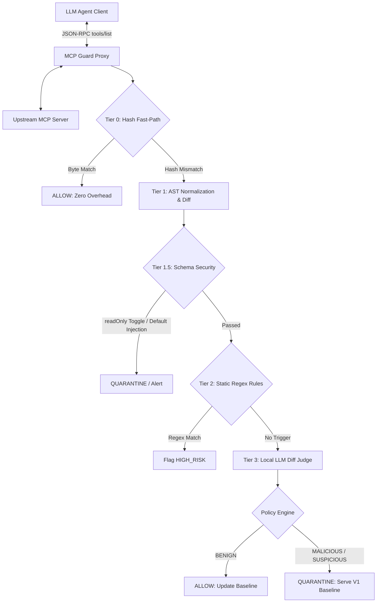

# Semantic Drift Detection for Model Context Protocol (MCP) Tool Definition Updates

[]()
[]()
[]()
[]()

> **Abstract**: Model Context Protocol (MCP) servers expose dynamic tool manifests to LLM agents. Exact cryptographic pinning triggers false alarms on every benign docstring clarification or parameter refactor (observed on 100% of non-identical updates), while unpinned execution permits covert tool-poisoning attacks. This repository implements and evaluates **MCP Semantic Drift Detection**—a multi-tier defensive middleware that separates byte-level change detection from semantic security analysis.

---

## 1. Repository Structure

```
.
├── CHANGELOG.md                 # Complete audit log of all code, dataset, and manuscript revisions
├── ENVIRONMENT.md               # Base environment and tooling specifications
├── LICENSE                      # MIT License
├── README.md                    # This documentation file
├── requirements.txt             # Python package dependencies
├── config.json                  # Default proxy and guard configuration
│
├── data/                        # Curated datasets and benchmark evaluation splits
│   ├── raw_mcp_tools/           # Mined MCP tool definitions across 28 open-source repositories (621 transitions)
│   ├── master_benchmark.jsonl   # 370-sample master dataset across 19 disjoint MCP server clusters
│   ├── matched_pairs.jsonl      # 24-sample paired docstring dataset isolating phrasing from semantics
│   ├── redteam_baseline.jsonl   # 30-sample adversarial suite across 10 attack vectors
│   ├── redteam_v2.jsonl         # 28-sample 14-category upgraded adversarial suite
│   ├── train_split.jsonl        # 260-sample train split (disjoint server clusters)
│   ├── dev_split.jsonl          # 54-sample dev split (disjoint server clusters)
│   └── test_split.jsonl         # 56-sample held-out test split (disjoint server clusters)
│
├── guard/                       # Core MCP Guard Middleware implementation
│   ├── middleware.py            # End-to-end multi-tier interceptor and response dispatcher
│   ├── baseline_store.py        # SQLite persistent storage for trusted tool definition baselines
│   ├── policy_engine.py         # Security policy rules (STRICT, BALANCED, PERMISSIVE, AUDIT)
│   ├── schema_security_rules.py # Tier 1.5 deterministic schema AST checks (readOnly, defaults, enum narrowing)
│   ├── static_rules.py          # Tier 2 pre-registered regex indicators for covert injection payloads
│   ├── semantic_judge.py        # Tier 3 local LLM semantic diff judge (Mode B structured diff prompt)
│   ├── audit_logger.py          # Structured JSON audit logging and alert telemetry
│   └── config.py                # Runtime configuration definitions
│
├── experiments/                 # Experimental pipelines, baselines, and ablation scripts
│   ├── phase2_extract_corpus.py # Historical mining script extracting 621 version transitions
│   ├── baseline_embedding.py    # TF-IDF lexical cosine similarity baseline calibration
│   ├── ablation_detector.py     # Systematic multi-tier ablation runner (Configs A through H)
│   ├── cross_validate.py        # 5-fold server-grouped cross-validation pipeline (GroupKFold)
│   ├── phase5_live_mcp_proxy.py # Live JSON-RPC socket proxy verification
│   └── redteam_v2_eval.py       # Upgraded adversarial benchmark evaluation
│
├── tests/                       # Automated regression, security, and verification test suite
│   ├── test_leakage.py          # Zero-leakage verification across server clusters and dataset splits
│   ├── test_schema_security.py  # Tier 1.5 deterministic schema security unit tests
│   ├── test_failure_policy.py   # FAIL_SECURE and FAIL_OPEN error handling and timeout tests
│   ├── test_rollback_safety.py  # Schema breaking vs compatible rollback unit tests
│   └── ...                      # 40 total unit and integration tests
│
├── paper.md                     # Full master research manuscript
└── results/                     # Empirical logs, evaluation outputs, and audit artifacts
```

---

## 2. Setup and Installation

### 2.1 Prerequisites
- **Python**: 3.11+
- **Ollama**: 0.3.0+ with `qwen3:8b` (for Tier 3 local LLM inference)

### 2.2 Installation
```bash
# Clone the repository
git clone https://github.com/anonymous-submission/mcp-semantic-drift.git
cd mcp-semantic-drift

# Create and activate virtual environment
python -m venv .venv
source .venv/bin/activate  # On Windows: .venv\Scripts\activate

# Install dependencies
pip install -r requirements.txt

# (Optional) Pull Ollama models for Tier 3 local judge evaluation
ollama pull qwen3:8b
ollama pull gemma3:4b
ollama pull qwen2.5:1.5b
```

---

## 3. Reproduction Commands

All reported figures, tables, and metrics in `paper.md` can be deterministically reproduced via the following commands:

### 3.1 Run Complete Test Suite (40/40 Passing)
```bash
python -m unittest discover tests
```

### 3.2 Verify Zero Data Leakage (Server-Disjoint Splits)
Verifies that no server cluster overlaps between train ($N=260$), dev ($N=54$), and test ($N=56$) splits:
```bash
python -m unittest tests/test_leakage.py
```

### 3.3 Run 5-Fold Server-Grouped Cross-Validation
Evaluates generalization across 19 disjoint server clusters ($N=370$ total instances):
```bash
python experiments/cross_validate.py
```
*Expected Output*: Mean $F_1 = 89.7\% \pm 6.2\%$, Recall = $100.0\% \pm 0.0\%$, Precision = $81.8\% \pm 10.3\%$, Benign FPR = $23.0\% \pm 4.1\%$.

### 3.4 Calibrate TF-IDF Lexical Baseline
Calibrates the lexical similarity baseline across the master dataset:
```bash
python experiments/baseline_embedding.py
```
*Expected Output*: Optimal threshold $\theta^* = 0.590$, yielding $F_1 = 68.8\%$ (Precision = $53.0\%$, Recall = $97.9\%$, FPR = $80.4\%$).

### 3.5 Run Multi-Tier Pipeline Ablation
Evaluates detection performance across Configurations A through H:
```bash
python experiments/ablation_detector.py
```

### 3.6 Run Live MCP Socket Proxy Integration Test
Simulates live client-proxy-server JSON-RPC interaction with dynamic interception and rollback:
```bash
python experiments/phase5_live_mcp_proxy.py
```

---

## 4. Architecture Overview



### Multi-Tier Interception Pipeline:
1. **Tier 0 (Hash Fast-Path, $0.024\text{ ms}$)**: Computes SHA-256 over normalized JSON. Byte-identical definitions pass immediately with zero added latency.
2. **Tier 1 (AST Normalization & Diffing, $0.080\text{ ms}$)**: Generates structured, canonical JSON AST diffs isolating additions, deletions, and schema modifications.
3. **Tier 1.5 (Deterministic Schema Security, $<0.10\text{ ms}$)**: Deterministically audits structural attack vectors including `readOnly: true -> false` privilege escalations, property default value injections, and parameter enum narrowing.
4. **Tier 2 (Static Pre-Registered Heuristics, $0.024\text{ ms}$)**: Audits diff text against 7 pre-registered regex indicators targeting exfiltration domains, shell execution commands, and permission override directives.
5. **Tier 3 (Local Semantic Diff Judge, $1.42\text{ s}$ on CPU)**: Evaluates structured diffs using a quantized local LLM (`Qwen3:8B` Mode B) inside strict XML sandboxes with structured JSON output schemas.

---

## 5. Security & Operational Policy Modes

| Policy Mode | Description | Action on `BENIGN` | Action on `SUSPICIOUS` | Action on `MALICIOUS` | Target Environment |
| :--- | :--- | :--- | :--- | :--- | :--- |
| **STRICT** | Zero-tolerance posture | `ALLOW` (if confidence $\ge 0.90$) | `QUARANTINE` | `QUARANTINE` | Autonomous enterprise agent pipelines |
| **BALANCED** *(Default)* | High-security, low-friction | `ALLOW` | `ALLOW` with Audit Telemetry | `QUARANTINE` | Production agent environments |
| **PERMISSIVE** | High-trust developer mode | `ALLOW` | `ALLOW` | `QUARANTINE` | Internal debugging |
| **AUDIT** | Passive observability | `ALLOW` | `ALLOW` (Log only) | `ALLOW` (Log only) | Baseline gathering & shadow deployments |

### Fail-Safe Error Handling:
- **`FAIL_SECURE`** *(Default in BALANCED/STRICT)*: On inference timeout (> 45s), JSON parse errors, or daemon disconnection, candidate updates are treated as `SUSPICIOUS` $\rightarrow$ `QUARANTINE`, falling back to the trusted $V_1$ baseline.
- **`FAIL_OPEN`** *(AUDIT only)*: Permits candidate update through while emitting an unverified warning event.

---

## 6. Dataset Provenance & Data Sheet

- **Historical Transition Corpus (`data/raw_mcp_tools/`)**: Mined across 28 open-source MCP repositories containing $\ge 2$ git release tags. Yielded 621 server transitions, 31 changed releases, and 123 total tool change events (110 additions/removals and 13 historical contract modifications).
- **Master Evaluation Benchmark (`data/master_benchmark.jsonl`)**: 370 total instances partitioned across 19 disjoint MCP server clusters into Train ($N=260$, 13 clusters), Dev ($N=54$, 3 clusters), and Test ($N=56$, 3 clusters). Zero server or tool name overlap exists across splits (verified in `tests/test_leakage.py`).
- **Matched Pairs Suite (`data/matched_pairs.jsonl`)**: 24 docstring updates paired across identical base tools to isolate lexical phrasing from malicious payload intent.
- **Adversarial Red-Team Suites**:
  - `data/redteam_baseline.jsonl` ($N=30$): 10 attack categories evaluating prompt injection, schema hijacking, prerequisite insertion, and exfiltration toggles.
  - `data/redteam_v2.jsonl` ($N=28$): 14 attack categories ($n=2$ per category) evaluating multi-step salami drift, subtle euphemisms, and schema security edge cases.

---

## 7. License and Attribution

- **Software**: Open-sourced under the [MIT License](LICENSE).
- **Data & Artifacts**: Released under [Creative Commons Attribution 4.0 International (CC-BY-4.0)](https://creativecommons.org/licenses/by/4.0/).
- **Paper & Documentation**: Published as an open-science submission package.
